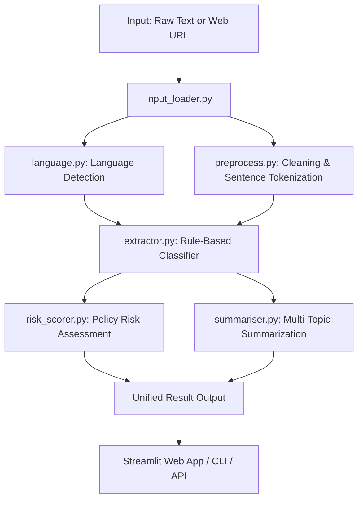

# System Architecture

The **Privacy Policy Analyzer** is structured as a modular pipeline designed to ingest, process, classify, and summarize privacy policies in both English and Danish.

## Pipeline Architecture

## Core Modules

### 1. `input_loader.py`
- Handles plain text input validation (minimum length check of 50 characters).
- Handles web page scraping via `trafilatura` with an automated fallback to `BeautifulSoup` when `trafilatura` is unavailable.
- Implements request headers (`User-Agent: PrivacyAnalyzerBot/1.0`) and network timeout handling (15 seconds).
- Enforces character bounds up to 200,000 characters.

### 2. `language.py`
- Detects whether the input text is in English (`en`) or Danish (`da`).
- Uses `langdetect` on the first 1,000 characters, with a fast heuristic fallback based on Danish morphological markers (`æ`, `ø`, `å`, `"vi "`, `"personoplysninger"`).

### 3. `preprocess.py`
- `clean_text`: Strips redundant whitespace and normalizes text layout.
- `split_sentences`: Splits the policy text into individual sentences based on sentence terminators (`.`, `!`, `?`), filtering out short fragments (< 10 characters).

### 4. `extractor.py`
- Classifies individual sentences into 7 privacy dimensions:
  1. `collection`
  2. `purpose`
  3. `sharing`
  4. `tracking`
  5. `retention`
  6. `security`
  7. `rights`
- Implements strict regex word-boundary pattern matching (`\b...\b`) to avoid false positive cross-lingual collisions (e.g., preventing Danish `"dele"` from matching English `"delete"` or `"deletion"`).
- Features negation handling to discard false positives on negated actions (e.g., *"We do not collect or sell personal data"*).
- Aggregates findings per category across all extracted sentences.

### 5. `risk_scorer.py`
- Analyzes extracted findings and calculates an overall privacy risk score:
  - Third-party data sharing: `+3`
  - High volume of personal data types: `+3` (when $\ge 3$ distinct data types are mentioned)
  - Tracking technologies / cookies: `+2`
  - Explicit user rights: `-1`
- Maps risk score to qualitative levels:
  - **Low**: Score $\le 3$
  - **Medium**: Score $4$ to $7$
  - **High**: Score $\ge 8$

### 6. `summariser.py`
- Produces clean, readable bullet points for each privacy category.
- Provides informative snippets from matched sentences or clarifies when a category is not clearly mentioned.
- Fully supports both standard 7 categories and legacy 4 categories.

### 7. `pipeline.py`
- Serves as the central orchestrator coordinating ingestion, preprocessing, extraction, risk scoring, and summarization into a unified JSON-serializable dictionary.

